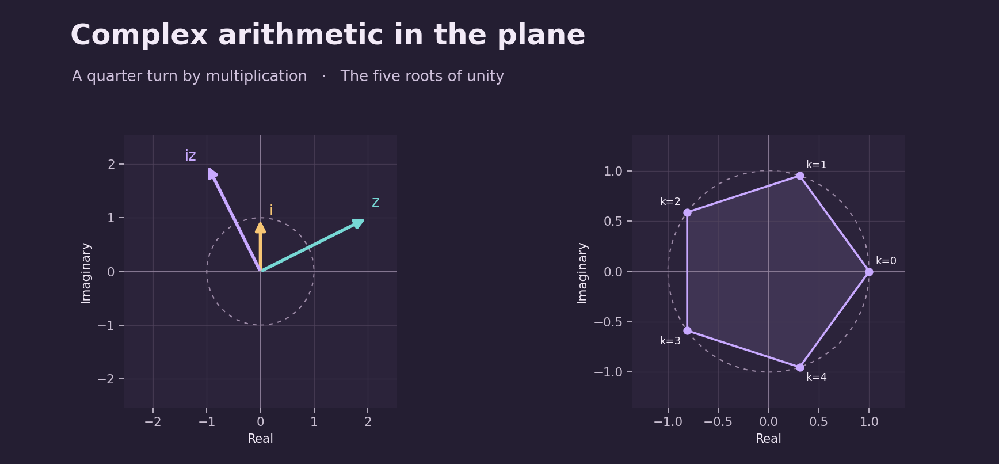

# Complex Plane Studio

[Open the interactive studio](https://pialbertshi.github.io/Complex-Plane-Studio/) · [中文说明](README.zh-CN.md)

What does multiplying by *i* do to a vector? How can five different numbers all have fifth power 1? Explore these questions on an Argand diagram, then reproduce the coordinates with a header-only C++17 complex-number type.

[](https://pialbertshi.github.io/Complex-Plane-Studio/)

## Explore the plane

| Example | Input | Geometric result |
|---|---|---|
| Quarter turn | (2 + i) × i | −1 + 2i. The vector turns 90° counterclockwise at constant length. |
| Roots of unity | z = 1, n = 5 | Five points on the unit circle, each 72° from the next. |
| Reflection | Conjugate of 2 + 1.5i | 2 − 1.5i. The midpoint lies on the real axis. |

The studio supports addition, subtraction, multiplication, division, conjugation, integer powers and all n-th roots. Click the plot to change *z*, or type both coordinates. The table reports every result in Cartesian and polar form. Equal scales on the real and imaginary axes preserve angles on mobile and desktop.

## Library and conventions

```cpp
#include "argand/complex.hpp"

using Number = argand::Complex<double>;
const Number z{2.0, 1.0};
const auto turned = z * Number{0.0, 1.0};  // -1 + 2i
const auto values = argand::roots(Number{-8.0, 0.0}, 3);
```

| Operation | Convention |
|---|---|
| Arithmetic | Operators return values. Compound assignment updates the left operand safely, including self-multiplication. |
| Polar form | Radius is nonnegative. The C++ argument is in radians from `atan2`; the studio also displays degrees. The CLI leaves the argument blank at zero. |
| Integer powers | Exponentiation by squaring, including negative exponents. The zero exponent returns one. A negative power of zero raises a domain error. |
| n-th roots | Return all roots in order k = 0,…,n−1 at angles (arg z + 2πk)/n. At zero the returned list retains multiplicity. |
| Elementary functions | Principal log, exp, trigonometric and hyperbolic functions use the standard complex library. Division by zero and log of zero raise domain errors. |

The native library accepts floating-point scalar types. The browser demonstrates degrees up to 12 and coordinates between −12 and 12. The native root API supports degrees from 1 to 4096.

## Build and run

Use CMake 3.20 or newer and a C++17 compiler:

```sh
cmake -S . -B build -DCMAKE_BUILD_TYPE=Release
cmake --build build --config Release
ctest --test-dir build -C Release --output-on-failure
./build/argand_cli multiply 2 1 0 1
./build/argand_cli roots -8 0 3
```

With Visual Studio on Windows the executable is `build\Release\argand_cli.exe`. The CLI writes CSV with the index, real part, imaginary part, magnitude and argument in radians. For the cube roots of −8 the points are 1 + √3 i, −2 and 1 − √3 i, up to floating-point rounding.

## Verification and provenance

Seven native test groups cover arithmetic against `std::complex`, aliasing, polar conventions, integer powers, all-root round trips, elementary functions and invalid domains. CI also exports 35 C++ operation cases and checks all 45 resulting complex values against the browser's JavaScript implementation. This comparison exercises the exact module used by the live studio.

```sh
./build/argand_cli --fixtures build/reference.json
node tests/check_browser.mjs build/reference.json
python -m http.server 8000 --directory docs
```

Open `http://localhost:8000` for the local studio. The optional [figure script](tools/render_preview.py) regenerates the plot from the CLI output using Matplotlib.

The project began as a student C++14 exercise in templates, operator overloading and polar coordinates. The portfolio edition retains those ideas, separates computation from console input, and adds value semantics, reproducible examples, tests and an interactive display. The [original implementation](coursework/original) and [historical repository snapshot](https://github.com/piAlbertSHI/Complex-Plane-Studio/tree/d7cb5ae94c4302db99aac8494e32230463bb942b) preserve the coursework.

