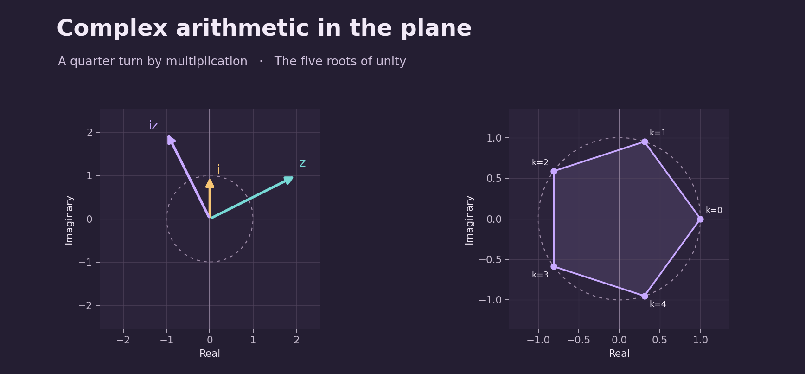

# 复平面运算工作室

[打开交互演示](https://pialbertshi.github.io/Complex-Plane-Studio/) · [English](README.md)

把 2 + i 乘以 i，得到 −1 + 2i。算式只有一行，复平面上则能看出它绕原点逆时针旋转了 90°。这个由学生时代的 C++ 模板与运算符重载课程项目扩展而来的作品，把同一组数学运算做成了可复用的 C++17 类型、命令行示例和交互图。

## 动手看几何关系

- **Quarter turn** 展示乘以 i 的旋转。点击平面修改 z，观察实部、虚部、模长和辐角怎样变化。
- **Roots of unity** 给出 1 的全部五次根。相邻根相差 72°，改变次数可观察多边形的变化。
- **Reflection** 显示共轭关于实轴的镜像。另可选择加法、减法、除法和整数幂。

## 数学约定与复核

库用弧度表示辐角，网页同步给出角度。n 次根从 k = 0 到 n−1 排列；零的根按重数返回。复数除以零、零的负整数幂和零的对数有明确的错误处理。普通算术返回值对象，运算过程与控制台输入相互独立。

7 组原生测试覆盖标准库对照、自乘自除、极坐标、整数幂、开根回代、初等函数和定义域。网页采用独立的 JavaScript 运算模块，持续集成会将其与 35 个 C++ 算例产生的 45 个复数结果逐一核对。[构建命令与示例](README.md#build-and-run)

原课程版本与新版实现均可查看，便于比较从交互式控制台练习到库接口的变化。[课程源码](coursework/original) · [新版 C++ 接口](include/argand/complex.hpp)
